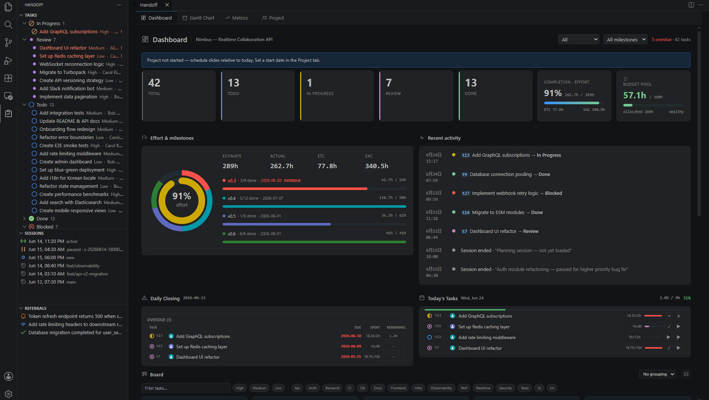
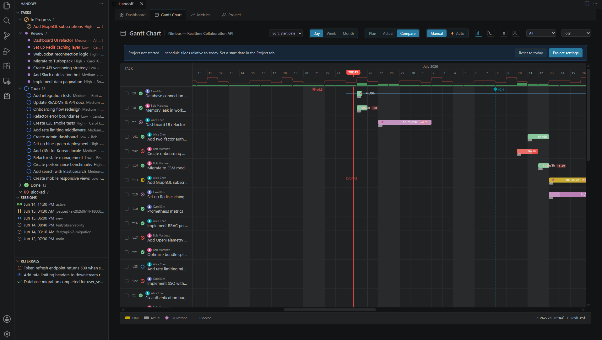
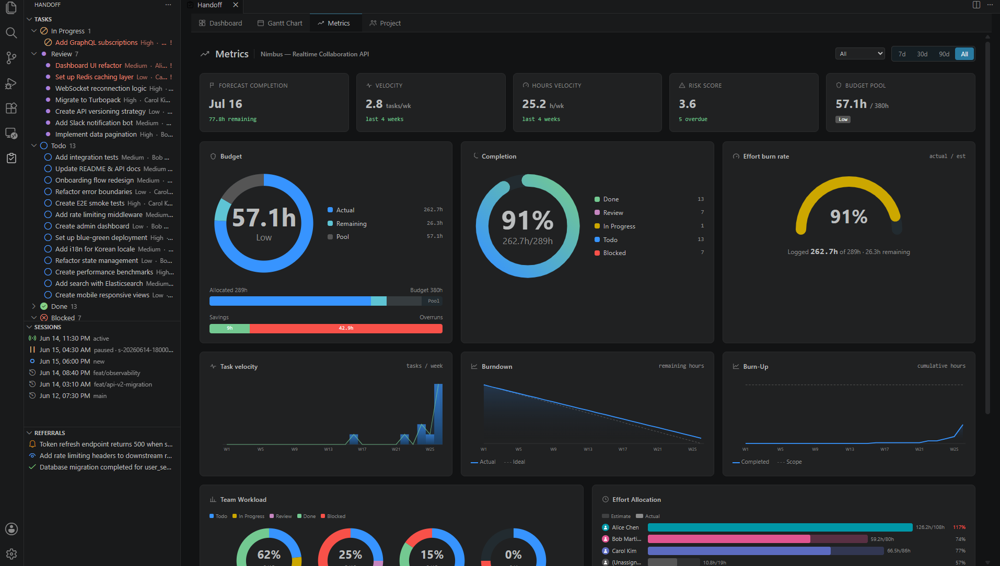

<p align="center">
  <picture>
    <source media="(prefers-color-scheme: dark)" srcset="docs/logo-dark.png">
    
  </picture>
</p>

<p align="center">
  <strong>Visualize and manage <a href="https://github.com/alphaelements/handoff-mcp">handoff-mcp</a> tasks, sessions, and metrics — right inside VS Code.</strong>
</p>

<p align="center">
  <a href="https://marketplace.visualstudio.com/items?itemName=alphaelements.handoff-vscode"></a>
  <a href="https://marketplace.visualstudio.com/items?itemName=alphaelements.handoff-vscode"></a>
  <a href="https://marketplace.visualstudio.com/items?itemName=alphaelements.handoff-vscode"></a>
</p>



## Features

**Task Explorer** — Tree view with status icons, priority badges, and milestone filtering. Click any task to open its detail panel with done-criteria checklist, schedule, and time tracking.

**Nested Workspaces** — Recursively scans a workspace for multiple `.handoff/` directories (e.g. a monorepo with sub-projects), groups tasks by project in the Task Explorer, and tags task cards with a project badge. A shared project selector filters the Dashboard, Gantt Chart, Metrics, Team Panel, and Session Timeline consistently, with your selection remembered across reloads.

**Dashboard** — Project overview showing task counts by status, completion percentage, effort budget burn-down, Kanban board, work timeline, and recent activity feed.

**Gantt Chart** — Interactive timeline with month/day headers, drag-to-reschedule, milestone grouping, auto-scroll to today, and hide-completed/per-row visibility toggles to declutter long-running projects.



**Kanban Board** — Drag-and-drop cards across status columns (todo / in_progress / review / done). Status changes write back to `.handoff/` automatically.

**Metrics Panel** — Effort hours (estimated vs actual), velocity trends, session duration analytics, and filterable label/milestone breakdowns.



**Time Tracker** — Start/stop timer linked to the active task. Idle detection pauses automatically. Accumulated time persists across VS Code restarts. AI agents can control the timer remotely via [handoff-mcp](https://github.com/alphaelements/handoff-mcp) — start, stop, pause, and resume from the coding session.

**Session Browser** — Browse AI session history with summaries, decisions, blockers, and file pointers from each handoff.

**Effort Budget** — Configure total project hours in `config.toml`. The dashboard shows remaining budget and burn rate.

## Setup

### 1. Install handoff-mcp (the MCP server)

This extension visualizes data created by [handoff-mcp](https://github.com/alphaelements/handoff-mcp) — an MCP server that gives AI coding agents persistent memory across sessions. Install it first:

```bash
npm install -g handoff-mcp-server
```

Then register it in Claude Code. Run:

```bash
claude mcp add -s user handoff -- handoff-mcp
```

The `-s user` flag registers it globally (available in all projects). You can verify with `claude mcp get handoff`.

Or manually add to `~/.claude.json`:

```json
{
  "mcpServers": {
    "handoff": {
      "type": "stdio",
      "command": "handoff-mcp",
      "args": []
    }
  }
}
```

### 2. Register the skill (optional but recommended)

handoff-mcp provides a [skill file](https://github.com/alphaelements/handoff-mcp/tree/main/skills/handoff) that teaches the agent to automatically load/save context. Copy it to your Claude Code user skills directory:

**From npm** (if you installed globally in step 1):

```bash
cp -r $(npm root -g)/handoff-mcp-server/skills/handoff ~/.claude/skills/
```

**From GitHub**:

```bash
git clone --depth 1 https://github.com/alphaelements/handoff-mcp.git /tmp/handoff-mcp
cp -r /tmp/handoff-mcp/skills/handoff ~/.claude/skills/
```

With the skill installed, the agent will automatically call `handoff_load_context` at session start and `handoff_save_context` at session end — no manual prompting needed.

### 3. Add to your project's CLAUDE.md

Add the following to your project's `CLAUDE.md` so the agent uses handoff consistently across sessions:

```markdown
## Session Handoff

This project uses handoff-mcp for session continuity.

- **Session start**: Call `handoff_load_context` to load previous session state.
  If not initialized, call `handoff_init` with the project name.
  If `session_guidance` is present, immediately call `handoff_save_context`
  with `session_status: "active"` to establish a persistent session before
  starting work.
- **Session end**: Call `handoff_save_context` with a summary, decisions, and blockers.
- **During work**: Use `handoff_update_task` to track progress.
  Mark tasks `in_progress` when starting, `done` when complete.
```

### 4. Initialize your project

In an AI coding session (e.g. Claude Code), ask the agent to initialize handoff:

```
> Initialize handoff for this project
```

This creates a `.handoff/` directory in your project root with `config.toml` and empty `tasks/` and `sessions/` directories.

### 5. Install this extension

Search **"Handoff"** in the VS Code Marketplace, or run:

```
ext install alphaelements.handoff-vscode
```

### 6. Open your project

Open the folder containing `.handoff/` in VS Code. The extension activates automatically:

- **Task Explorer** appears in the sidebar
- **Dashboard** is available via `Ctrl+Shift+P` / `Cmd+Shift+P` → `Handoff: Open Dashboard`
- **Status Bar** shows task counts and active timer

### Requirements

- VS Code 1.90+
- A project with a `.handoff/` directory (created by [handoff-mcp](https://github.com/alphaelements/handoff-mcp))

### Try it without handoff-mcp

Clone this repo and open it in VS Code — it includes a `.handoff/` directory with realistic demo data (42 tasks, sessions, milestones, and effort budget). No MCP server needed to explore the UI.

## Commands

All commands are available via the Command Palette (`Ctrl+Shift+P` / `Cmd+Shift+P`):

| Command                          | Description                              |
| -------------------------------- | ---------------------------------------- |
| `Handoff: Open Dashboard`        | Open the main dashboard panel            |
| `Handoff: Open Gantt Chart`      | Open the Gantt chart                     |
| `Handoff: Open Metrics`          | Open the metrics panel                   |
| `Handoff: Open Team`             | Open the team panel                      |
| `Handoff: Open Task`             | Open a task detail panel                 |
| `Handoff: Focus on Handoff View` | Show the task explorer sidebar           |
| `Handoff: Refresh Tasks`         | Re-scan `.handoff/` for changes          |
| `Handoff: Create Task`           | Create a new task via quick pick         |
| `Handoff: Filter Tasks`          | Set filter conditions                    |
| `Handoff: Set Sort`              | Change task sort order                   |
| `Handoff: Set Status`            | Change task status                       |
| `Handoff: Set Priority`          | Change task priority                     |
| `Handoff: Set Milestone`         | Assign a milestone                       |
| `Handoff: Edit Schedule`         | Edit start date, due date, and estimates |
| `Handoff: Add Dependency`        | Add a task dependency                    |
| `Handoff: Remove Dependency`     | Remove a task dependency                 |
| `Handoff: Toggle Done Criterion` | Check/uncheck a done criterion           |
| `Handoff: Set Display Order`     | Set task display order                   |
| `Handoff: Log Time`              | Log hours to a task                      |
| `Handoff: Pause Timer`           | Pause the running timer                  |
| `Handoff: Stop Timer`            | Stop timer and save elapsed time         |
| `Handoff: Cancel Timer`          | Discard timer without saving             |
| `Handoff: Timer Actions`         | Quick pick for timer controls            |
| `Handoff: Set Referral Status`   | Update a cross-project referral status   |

## Configuration

Key settings under `handoff.*` in VS Code Settings:

| Setting                                  | Default     | Description                                                    |
| ---------------------------------------- | ----------- | -------------------------------------------------------------- |
| `handoff.autoRefresh`                    | `true`      | Watch `.handoff/` for changes and refresh automatically        |
| `handoff.locale`                         | `"auto"`    | UI language (`en` or `ja`). `auto` = follow VS Code            |
| `handoff.defaultView`                    | `dashboard` | Default panel view when opening Handoff                        |
| `handoff.statusBar.enabled`              | `true`      | Show task count and timer in the status bar                    |
| `handoff.gantt.defaultScale`             | `day`       | Gantt chart time scale (`day` or `week`)                       |
| `handoff.timeTracker.idleTimeoutMinutes` | `3`         | Minutes of inactivity before pausing the timer                 |
| `handoff.taskExplorer.sortBy`            | `order`     | Default sort: `order`, `priority`, `updated`, `created`, `due` |

For the full list of 22 settings plus `config.toml` reference, see [Configuration](docs/wiki/Configuration.md).

## Project Structure

The extension reads from the `.handoff/` directory created by [handoff-mcp](https://github.com/alphaelements/handoff-mcp):

```
your-project/
└── .handoff/
    ├── config.toml          # Project name, effort budget
    ├── tasks/
    │   ├── t1-auth/
    │   │   └── _task.done.json
    │   └── t2-api/
    │       └── _task.in_progress.json
    └── sessions/
        └── s-20260619-.../
            └── session.json
```

Task status is encoded in the filename: `_task.todo.json`, `_task.in_progress.json`, `_task.review.json`, `_task.done.json`.

## Demo Data

This repository includes a `.handoff/` directory with a realistic sample project ("Nimbus — Realtime Collaboration API") containing 42 tasks across multiple milestones, 6 AI sessions, effort budgets, assignee calendars, and more. Clone the repo, open it in VS Code, and the extension will pick it up automatically.

## Issues & Feedback

Found a bug or have a feature request? Please [open an issue](https://github.com/alphaelements/handoff-vscode/issues/new/choose).

## Documentation

For detailed guides on each feature, see the [Wiki](docs/wiki/Home.md):

[Getting Started](docs/wiki/Getting-Started.md) · [Task Explorer](docs/wiki/Task-Explorer.md) · [Task Detail](docs/wiki/Task-Detail.md) · [Dashboard](docs/wiki/Dashboard.md) · [Gantt Chart](docs/wiki/Gantt-Chart.md) · [Metrics](docs/wiki/Metrics.md) · [Time Tracker](docs/wiki/Time-Tracker.md) · [Session Browser](docs/wiki/Session-Browser.md) · [Team Panel](docs/wiki/Team-Panel.md) · [Configuration](docs/wiki/Configuration.md) · [FAQ](docs/wiki/FAQ.md)

## Links

- [handoff-mcp](https://github.com/alphaelements/handoff-mcp) — The MCP server that creates the `.handoff/` data this extension visualizes
- [VS Code Marketplace](https://marketplace.visualstudio.com/items?itemName=alphaelements.handoff-vscode)

## License

Source code is proprietary (All rights reserved). This repository contains documentation, examples, and issue templates.
