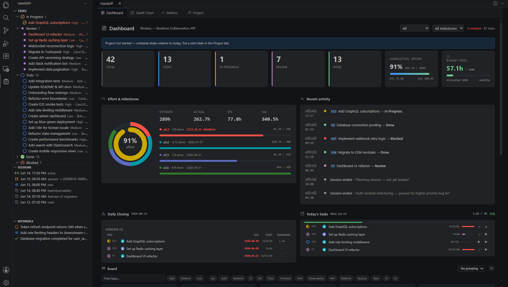

# Dashboard

The Dashboard is the main overview panel for your project. It shows task counts, effort tracking, a Kanban board, activity feed, and daily review tools in one place.

## Opening the Dashboard

- **Command Palette**: `Handoff: Open Dashboard`
- **Status Bar**: Click the task count item (e.g. `3 todo - 2 in progress`)
- **Default View**: Set `handoff.defaultView` to `dashboard` to open it automatically when launching Handoff

## Summary Cards

The top row shows key project indicators at a glance:

| Card | Description |
|------|-------------|
| Total | Total number of tasks in the project |
| Todo | Tasks not yet started |
| In Progress | Tasks currently being worked on |
| Review | Tasks awaiting review |
| Done | Completed tasks |
| Completion | Percentage complete, with effort hours (e.g. `44h / 82h`) and a progress bar |

The completion card also displays **ETC** (Estimated Time to Completion) and **EAC** (Estimate at Completion) values derived from remaining task estimates and current actuals.

## Effort and Milestones

This section provides a deeper view into how effort is distributed across the project.

### Budget Donut Chart

A donut chart shows how the project's effort budget (set in `config.toml`) is allocated:

| Segment | Description |
|---------|-------------|
| Actual | Hours already spent (`actual_hours` across all tasks) |
| Remaining | Estimated hours left on active tasks |
| Pool | Unallocated budget reserve |

The center of the chart displays the pool amount and a status label — **Healthy** (green, > 30%), **Low** (yellow, 10-30%), **Critical** (red, < 10%), or **Overbudget** (red, pool exhausted). See [Configuration](Configuration.md) for how to set your total budget.

### Milestone Progress

Horizontal progress bars show completion for each milestone defined in `config.toml`. Each bar displays actual vs. estimated hours and the number of completed tasks.

## Recent Activity

A chronological feed showing:

- Task status changes (e.g. "t5 moved to review")
- Session start and end events
- Time tracking entries

Click any activity item to navigate to the related task or session.

## Today's Tasks

A focused list of tasks that are relevant for today's work:

- Tasks with status `in_progress`
- Tasks with a `due_date` of today or earlier that are not yet complete
- Tasks marked with the `NEXT` flag

Blocked, done, and skipped tasks are excluded — they are not actionable today.

You can change task status and log time directly from this panel.

## Daily Closing

A quick end-of-day review section that summarizes:

- Tasks completed today
- Time logged today
- Tasks still in progress
- Any new blockers

Use Daily Closing to update task statuses and add notes before ending your work session.

## Kanban Board

The Kanban board provides a card-based view of tasks across four columns:

| Column | Status |
|--------|--------|
| Todo | `todo` |
| In Progress | `in_progress` |
| Review | `review` |
| Done | `done` |

### Cards

Each card displays:

- Priority badge (P0–P3) and task ID
- Task title
- Label tags
- Done criteria progress bar (e.g. `2/4`)
- Effort hours (e.g. `11/16h`)
- Due date
- **Overdue indicator**: cards past their due date get a red border

### Drag and Drop

Drag a card from one column to another to change its status. The change is written back to the `.handoff/` directory automatically. A confirmation toast appears briefly after each move.

### Undo

All state mutations on the Dashboard — status changes, timer actions, remaining hours edits, and Kanban moves — support undo. After any change, an "Undo" action appears in the notification toast. Click it to revert the change immediately.

## Keyboard Shortcuts

| Action | Shortcut |
|--------|----------|
| Refresh data | The Dashboard refreshes automatically when `.handoff/` files change |
| Switch views | Use the tab bar at the top of the panel to switch between Dashboard, Gantt Chart, and Metrics |

## Related Pages

- [Task Explorer](Task-Explorer.md) — sidebar tree view
- [Gantt Chart](Gantt-Chart.md) — timeline view
- [Metrics](Metrics.md) — project analytics
- [Configuration](Configuration.md) — settings reference
