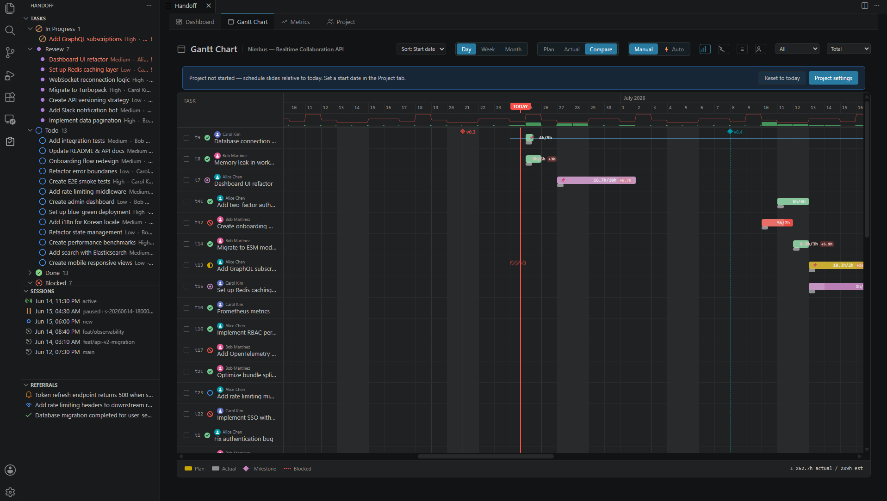

# Gantt Chart

The Gantt Chart gives you a timeline view of every task in your project. Each task appears as a horizontal bar spanning its scheduled dates, color-coded by status, with milestone markers, dependency arrows, and a today line so you can see at a glance where things stand.

Open it from the Command Palette: **Handoff: Open Gantt Chart**.

## Reading the Chart

Each bar represents one task:

- **Position** — the bar starts at `start_date` and ends at `due_date` (from `schedule` in the task JSON). If no start date is set, the task's `created_at` is used instead.
- **Color** — matches the task status (blue for todo, yellow for in-progress, purple for review, green for done, red for blocked, gray for skipped).
- **Hours label** — the right side of each bar shows `actual / estimate` hours. The label turns red when actual hours exceed the estimate.
- **Milestone diamonds** — milestone dates appear as diamond markers on the timeline header. Tasks assigned to a milestone are grouped together when milestone grouping is enabled.
- **Dependency arrows** — if a task declares dependencies, arrows connect the predecessor bar to the dependent bar.
- **Today line** — a vertical red line marks the current date. The chart auto-scrolls to keep today visible when you first open it.

## View Modes

Use the toolbar buttons at the top of the chart to switch between three modes:

| Mode | What it shows |
|------|---------------|
| **Plan** | Bars based on `start_date` and `due_date` only — the original schedule. |
| **Actual** | Bars based on `created_at` and `completed_at` — when work actually happened. In-progress tasks extend to today. |
| **Compare** | Overlays plan and actual bars so you can see where the schedule slipped or came in early. The plan bar appears semi-transparent behind the actual bar. |

## Time Scale

Toggle between **Day** and **Week** zoom using the scale buttons in the toolbar. Day view shows individual date columns; week view compresses the timeline for a broader overview. You can also scroll horizontally to navigate through time, and click **Scroll to Today** to jump back to the current date.

The default scale is controlled by the `handoff.gantt.defaultScale` setting (`day` or `week`).

## Drag Interactions

The Gantt Chart is fully interactive — you can reschedule tasks directly by dragging:

- **Move a task** — drag the entire bar left or right to shift both `start_date` and `due_date` by the same number of days.
- **Resize a task** — drag the left edge to change `start_date`, or the right edge to change `due_date`. This stretches or shrinks the task duration.
- **Create a dependency** — drag from one bar's connector handle to another bar to add a dependency link.

All changes are written back to the `.handoff/` task files automatically.

## Milestone Grouping

When milestone grouping is enabled (via the toolbar toggle or Gantt Settings), tasks are organized into collapsible groups by milestone. Each group header shows the milestone name, date, and a summary of task progress within that milestone.

Tasks with no milestone appear in an "Unassigned" group at the bottom.

## Workload View

The workload view adds a row below the chart showing each assignee's capacity utilization per day or week. Bars indicate how many hours are scheduled versus available, helping you spot overallocation before it becomes a problem.

Toggle workload visibility in the Gantt Settings panel.

## Progress Line

The progress line (sometimes called an "ikazuchi line") draws a zigzag line across the chart showing how far ahead or behind schedule each task is relative to today. Tasks that are on track appear at the today line; tasks that are behind pull the line to the left, and tasks ahead of schedule push it to the right.

This gives you an instant visual read on overall project health without checking each task individually.

## Filtering and Sorting

You can filter the Gantt Chart by:

- **Milestone** — show only tasks in a specific milestone
- **Assignee** — show only tasks assigned to a specific person
- **Status** — hide completed or skipped tasks to focus on active work

Sort options include start date, due date, priority, and custom order.

## Gantt Settings

Click the **Gantt Settings** button in the toolbar to open the settings panel, where you can configure:

- Default time scale (day / week)
- Sort order
- Milestone grouping on/off
- Assignee grouping on/off
- Workload view on/off
- Assignee filter

These settings are saved to `config.toml` under `[gantt_view]` and persist across sessions.

---

**See also:** [Dashboard](Dashboard.md) | [Metrics](Metrics.md) | [Configuration](Configuration.md)
