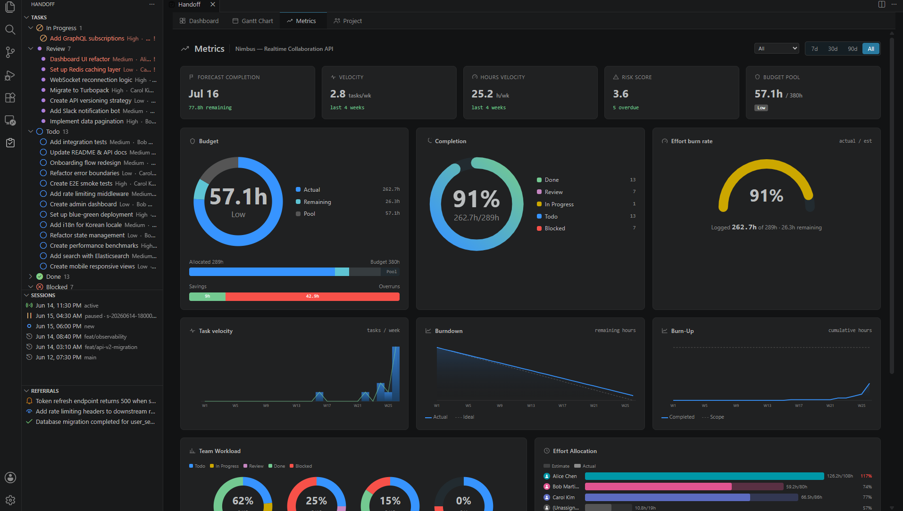

# Metrics

The Metrics panel gives you a data-driven view of project health: effort budget, completion trends, velocity, estimation accuracy, and more. Open it from the Command Palette: **Handoff: Open Metrics**.



## KPI Cards

The top row shows key performance indicators at a glance:

| Card | Description |
|------|-------------|
| **Day** | Current project day (working days elapsed since the earliest task start date) |
| **Velocity** | Average tasks completed per week over the selected period |
| **Session Hours** | Total hours across all recorded AI sessions |
| **Overdue** | Number of tasks past their due date that are not yet done |
| **Budget** | Total effort budget hours from `config.toml`, with a status indicator |
| **Completion** | Percentage of tasks in done status, shown as a progress ring |

## Effort Budget

The Budget donut chart visualizes how your project's hour budget is being used. The budget is defined in `config.toml`:

```toml
[effort_budget]
total_hours = 380
```

The chart breaks the budget into segments:

| Segment | Meaning |
|---------|---------|
| **Actual** | Hours already spent (`actual_hours` across all tasks) |
| **Remaining** | Hours left on active tasks (`estimate - actual` for in-progress tasks) |
| **Pool** | Unallocated hours — budget not yet assigned to any task |
| **Overbudget** | When total commitments exceed the budget, this segment shows the overage |

### Pool Status

The pool is the buffer between what you have budgeted and what you have committed. Its health is indicated by color:

| Status | Condition | Color |
|--------|-----------|-------|
| **Healthy** | Pool > 30% of total budget | Green |
| **Low** | Pool between 10% and 30% | Yellow |
| **Critical** | Pool between 0% and 10% | Red |
| **Overbudget** | Pool is negative (commitments exceed budget) | Red, highlighted |

### How the Pool Changes

The pool adjusts automatically as tasks are completed:

- **Savings** — when a task finishes under its estimate (actual < estimate), the difference flows back into the pool.
- **Overruns** — when a task exceeds its estimate (actual > estimate), the excess is deducted from the pool.

No manual action is needed — the pool is calculated automatically from your task estimates and actuals. When a task finishes under its estimate, the saved hours return to the pool. When a task goes over, the excess is deducted.

## Completion

A donut chart showing the ratio of done tasks to total tasks. The center displays the completion percentage. Segments are colored by status so you can see the breakdown of todo, in-progress, review, done, blocked, and skipped.

## Effort Burn Rate

A horizontal bar chart showing estimated vs. actual hours per milestone. This helps you see which milestones are tracking to plan and which are running over.

## On-Time Delivery

A donut chart showing the percentage of completed tasks that finished on or before their due date. This is a trailing indicator of schedule reliability — a low on-time rate suggests estimates or scope need adjustment.

## Velocity

A bar chart showing the number of tasks completed per week. A trend line overlays the bars so you can see whether the team is accelerating, steady, or slowing down.

Velocity is calculated over the selected time period and is used internally to project estimated completion dates.

## Burndown

A line chart tracking remaining estimated hours over time. The line should trend downward toward zero as tasks are completed. A flat or rising line indicates that new work is being added faster than existing work is being finished.

## Burn-Up

The inverse of the burndown — a line chart showing cumulative completed work over time. The vertical axis represents total hours completed; the horizontal axis is time. A second line shows the total scope (sum of all estimates), so you can see both progress and scope changes on a single chart. When scope is stable, the two lines converge as the project nears completion.

## Label and Milestone Breakdowns

Pie charts showing the distribution of tasks by label and by milestone. These help you understand where effort is concentrated — for example, whether backend tasks dominate or whether a single milestone is absorbing most of the work.

## Period Filter

All time-based charts respect the period filter in the toolbar:

| Period | Scope |
|--------|-------|
| **7 days** | Last week |
| **30 days** | Last month |
| **90 days** | Last quarter |
| **All** | Entire project history |

Selecting a shorter period focuses the charts on recent trends; selecting "All" gives the full picture.

## Milestone Filter

You can also filter all charts to a single milestone using the milestone dropdown. This is useful for reviewing progress toward a specific release target.

---

**See also:** [Dashboard](Dashboard.md) | [Gantt Chart](Gantt-Chart.md) | [Configuration](Configuration.md)
